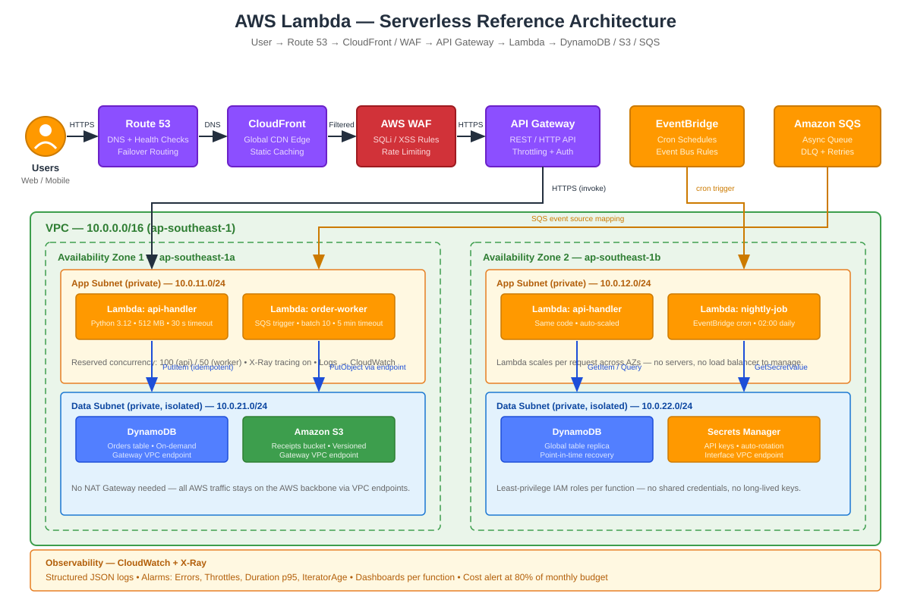

# AWS Lambda — Serverless Done Right


> **Serverless is not "no servers". It is "servers you never see, patch, or pay for while idle."**
> This guide shows how to run production workloads on AWS Lambda — event-driven,
> VPC-aware, observable, and cheaper than the EC2 fleet it replaces — without the
> cold-start and timeout traps beginners fall into.

---

## TL;DR

| Question | Short answer |
|---|---|
| What is Lambda? | Run code without provisioning servers. AWS runs it, scales it, bills per millisecond. |
| When does it win? | Event-driven, spiky, or idle-heavy workloads — APIs, ETL, webhooks, cron jobs. |
| When does it lose? | Long-running jobs (>15 min), huge steady traffic, heavy local state. |
| The #1 beginner mistake | Putting Lambda in a VPC without VPC endpoints — every AWS API call then crawls through a NAT Gateway. |
| The #1 cost mistake | Over-provisioning memory "to be safe" — memory also buys CPU, so test, don't guess. |
| Cold starts | Real, but solvable: right-size memory, keep packages lean, use SnapStart / Provisioned Concurrency only where it pays. |

---

## Architecture



**Traffic flow:** `User → Route 53 → CloudFront / WAF → API Gateway → Lambda (private subnets, 2 AZs) → DynamoDB / S3 / SQS`

The diagram shows the full production shape: edge protection, a private VPC with
two Availability Zones, Lambda functions behind API Gateway, a DynamoDB table and
an S3 bucket reached through **VPC endpoints** (no NAT Gateway bill), plus an SQS
queue for async work and EventBridge for scheduled jobs.

---

## 🌍 In plain words — what is this, really?

Lambda lets you run a small piece of code without renting or managing a server at all. You just upload your function, and AWS only runs it when something happens — like a new order arriving or a file being uploaded — then shuts it down again. You pay only for the milliseconds it actually runs, not for idle time. Think of it like a food stall that only opens when a customer shows up: no customer, no cooking, no cost for keeping the kitchen open all day. It is perfect for short, occasional jobs, and a bad fit for work that needs to run non-stop for hours.

---

## Lambda vs. the alternatives

| | Lambda | ECS Fargate | EC2 |
|---|---|---|---|
| Server management | None | Minimal | Full |
| Scaling | Per-request, instant | Task-level, ~1 min | Manual / ASG, minutes |
| Billing | Per ms, only while running | Per vCPU / GB-second | Per hour, even idle |
| Max execution | 15 minutes | Unlimited | Unlimited |
| Best for | Events, APIs, glue code | Long-running containers | Full control, legacy apps |
| Cold starts | Yes (mitigable) | Task start time | None after boot |

**Rule of thumb:** if the workload sleeps most of the day, Lambda wins on cost.
If it runs flat-out 24/7, a right-sized Fargate task or EC2 instance is usually cheaper.

---

## The five things that decide whether Lambda works

### 1. Triggers are the architecture

Lambda does nothing until something invokes it. Design around the event source,
not the function:

| Trigger | Use it for | Watch out for |
|---|---|---|
| API Gateway | REST / HTTP APIs | 29 s integration timeout |
| SQS | Async processing, retries | Batch size vs. partial failures |
| S3 events | File processing pipelines | Eventual consistency, fan-out |
| EventBridge | Cron jobs, cross-service events | Rule pattern mistakes = silent drops |
| DynamoDB Streams | Change data capture | Shard iterator age alarms |

### 2. Memory = CPU = speed = cost

Lambda bills `memory × duration`. More memory also means more CPU, so a function
with 1024 MB often finishes **faster and cheaper** than the same code at 256 MB.
Profile with [AWS Lambda Power Tuning](https://github.com/alexcasalboni/aws-lambda-power-tuning)
instead of guessing.

### 3. Cold starts: measure, then mitigate

| Cause | Fix |
|---|---|
| Large deployment package | Slim dependencies, Lambda Layers, strip `.pyc` / tests |
| VPC attachment (ENI setup) | Use VPC endpoints; AWS has largely removed the ENI penalty |
| Heavy imports (boto3, pandas) | Lazy-import inside the handler, or use the AWS SDK for Python layer |
| Java / .NET runtimes | SnapStart (Java), or pick Python / Node for latency-sensitive paths |
| True latency SLA | Provisioned Concurrency — but only on the hot path, it costs while idle |

### 4. VPC: endpoints first, NAT Gateway last

A Lambda in a VPC **has no internet by default**. To reach DynamoDB, S3, or
Secrets Manager, add **Gateway endpoints (S3, DynamoDB — free)** and **Interface
endpoints** for the rest. A NAT Gateway works too, but it bills ~$32/month +
data processing before a single request runs. For outbound internet (rare),
a NAT Gateway or a Lambda outside the VPC is the answer.

### 5. Observability is not optional

- **Structured JSON logs** to CloudWatch — grep-able, queryable with Logs Insights.
- **X-Ray tracing** — see the slow hop (API Gateway → Lambda → DynamoDB) in one view.
- **Alarms that matter:** `Errors`, `Throttles`, `Duration` p95, `IteratorAge` (streams),
  `ConcurrentExecutions` approaching the account limit.

---

## Code

[`lambda.py`](lambda.py) is a complete, deployable example: an **order-processing
function** triggered by SQS, writing to DynamoDB, publishing results to S3, with
structured logging, partial-batch failure reporting, and idempotency via a
conditional write.

```python
# Handler sketch — full code in lambda.py
def handler(event, context):
    for record in event["Records"]:
        order = json.loads(record["body"])
        process_order(order)          # DynamoDB conditional write (idempotent)
    return {"batchItemFailures": []}  # only failed messages are retried
```

Deploy it with the AWS SAM template snippet in the file header, or zip it:

```bash
zip function.zip lambda.py
aws lambda create-function --function-name order-processor \
  --runtime python3.12 --handler lambda.handler \
  --role arn:aws:iam::123456789012:role/lambda-exec \
  --zip-file fileb://function.zip
```

---

## Cost model (ap-southeast-1, 2026)

- **Requests:** $0.20 per 1M requests (first 1M free every month).
- **Duration:** $0.0000166667 per GB-second.
- **Example:** 10M requests/month, 512 MB, 200 ms average →
  ~$17/month in duration + $1.80 in requests. The API Gateway in front
  usually costs more than Lambda itself.

---

## Common mistakes (learn from other people's bills)

1. **Recursive invocation** — a Lambda that writes to the S3 bucket that triggers it.
   Infinite loop, infinite bill. Always filter by prefix/suffix.
2. **No timeout on downstream calls** — a hung DynamoDB call burns the full 15 min.
3. **Logging everything at DEBUG in production** — CloudWatch Logs is the hidden cost.
4. **One giant function for everything** — split by trigger; deploy and scale independently.
5. **Ignoring concurrency limits** — default 1,000 concurrent executions per region;
   a runaway SQS backlog can throttle your API functions. Use **reserved concurrency**.


---

## Further reading

- [AWS Lambda Developer Guide](https://docs.aws.amazon.com/lambda/latest/dg/welcome.html)
- [AWS Lambda Power Tuning](https://github.com/alexcasalboni/aws-lambda-power-tuning)
- [Serverless Land patterns](https://serverlessland.com/patterns)
- [AWS Well-Architected — Serverless Lens](https://docs.aws.amazon.com/wellarchitected/latest/serverless-applications-lens/welcome.html)

---

*Part of the cloud engineering guide series — one topic, one repo, every day.*
